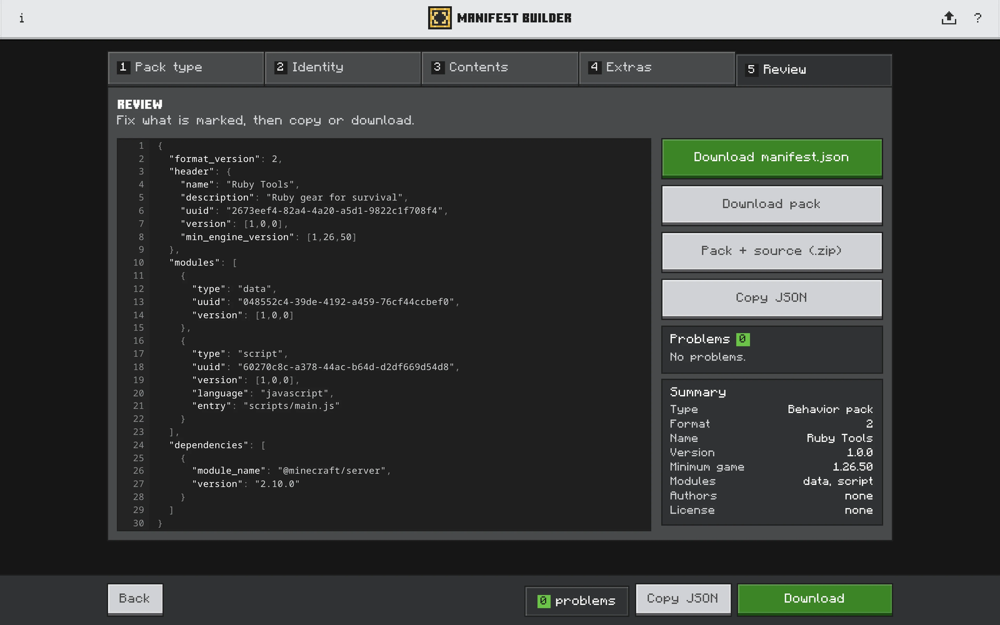
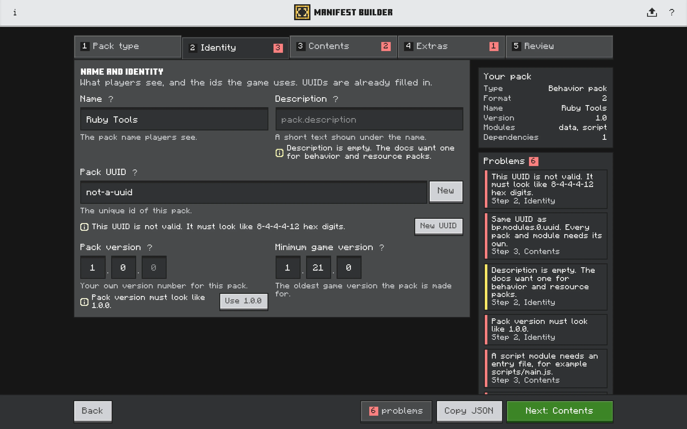
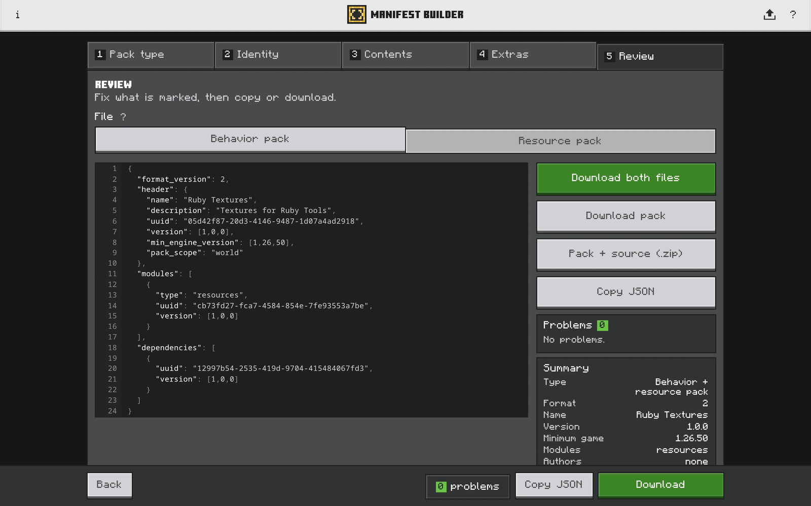
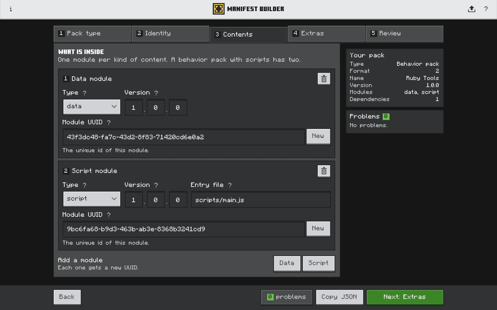

# Manifest Builder

A web form for every manifest.json option on Minecraft Bedrock, for format 2 and 3. It checks the result against the rules and writes the file for you.

**Open it:** https://duskaraa.github.io/manifest-builder/

## Features

- **Every option:** Header to subpacks
- **Script modules:** Pick versions
- **Templates:** Five pack types
- **UUIDs:** Generated, pairs linked
- **Validation:** Errors and warnings
- **Import:** Edit a manifest you have

## Screenshots

The problems list. Every line says what is wrong and which step it is on, and the field shows it too.

A behavior and resource pair: two manifests, linked by a dependency.

Modules: each one gets its own UUID, and a script module asks for an entry file.

## About

Manifest Builder is a single HTML file with no install and no account. It runs fully in the browser; your files never leave your computer.

Made by [Duskaraa](https://duskaraa.github.io/).

Not an official Minecraft product. Not approved by or associated with Mojang or Microsoft.

## License

[MIT](LICENSE). Minecraft textures, fonts and screenshots belong to Mojang and are not covered by this license.
